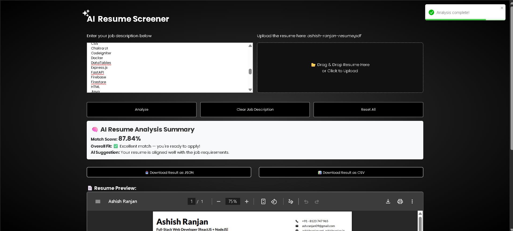

# AI Resume Screener

A full-stack AI-powered resume screening application that compares an uploaded PDF resume with a job description and returns a semantic match score along with overlapping terms.

The project uses a React and Vite frontend with a FastAPI backend. Resume text is extracted from PDF files using `pdfplumber`, converted into sentence embeddings with Sentence Transformers, and compared against the supplied job description using cosine similarity.

> This is a learning and portfolio project designed to demonstrate AI-assisted resume matching, PDF processing, NLP concepts, and full-stack integration.

## Features

- Upload resume in PDF format
- Paste a job description
- Extract resume text from PDF
- Semantic similarity scoring
- Resume-to-job match percentage
- Overlapping term extraction
- Match result display
- PDF preview
- Download result as JSON
- Download result as CSV
- Responsive React interface
- Separate React frontend and FastAPI backend

## Tech Stack

### Frontend

- React 18
- Vite
- Axios
- Material UI
- Emotion
- React Icons
- React Toastify
- styled-components
- Three.js
- React Three Fiber
- Drei

### Backend

- Python
- FastAPI
- Uvicorn
- python-multipart
- pdfplumber
- Sentence Transformers
- scikit-learn

## Repository Structure

```text
ai-resume-screener/
├── backend/
│   ├── main.py
│   ├── resume_matcher.py
│   └── requirements.txt
├── frontend/
│   ├── public/
│   ├── src/
│   ├── package.json
│   └── vite.config.js
├── .gitignore
├── image.png
└── README.md
```

Runtime folders such as backend uploads, Python virtual environments, frontend dependencies, and build output are excluded through `.gitignore`.

## How It Works

The application follows this workflow:

```text
Resume PDF
    |
    v
PDF Text Extraction
    |
    v
Text Cleaning
    |
    +----------------------+
    |                      |
    v                      v
Resume Text          Job Description
    |                      |
    +----------+-----------+
               |
               v
      Sentence Embeddings
               |
               v
       Cosine Similarity
               |
               v
        Match Percentage
               |
               v
     Common Term Matching
               |
               v
          API Response
```

## Resume Text Extraction

The backend uses `pdfplumber` to open the uploaded PDF and extract text from every page.

The extracted page text is joined into one string before matching.

## Semantic Matching

The backend uses the Sentence Transformers model:

```text
all-MiniLM-L6-v2
```

Both the resume text and job description are encoded into embeddings.

The project then uses:

```text
sklearn.metrics.pairwise.cosine_similarity
```

to compare the embeddings.

The similarity value is multiplied by `100` and rounded to two decimal places to produce the returned `matchScore`.

## Overlapping Terms

The backend also identifies common words between the resume and job description.

The implementation:

- extracts alphabetic words with at least two characters
- converts them to lowercase
- finds words common to both texts
- removes a small built-in stopword set
- returns up to 10 matching terms

These values are returned through the API under:

```text
skills
```

The field name is part of the existing project implementation.

## Backend API

The current backend exposes the following verified endpoint.

### Analyze Resume

```http
POST /upload
```

The endpoint accepts multipart form data.

Required fields:

```text
resume
jd
```

Where:

- `resume` is the uploaded PDF file
- `jd` is the job description text

### Response

The endpoint returns:

```json
{
    "filename": "resume.pdf",
    "matchScore": 87.84,
    "skills": ["react", "node"]
}
```

The exact score and matching terms depend on the supplied resume and job description.

## Backend Upload Storage

Uploaded resume files are saved inside:

```text
backend/uploads/
```

The upload directory is created automatically by the backend when necessary.

The repository `.gitignore` excludes this runtime upload directory from Git tracking.

## CORS

The FastAPI backend currently allows requests from:

```text
http://localhost:5173
```

This matches the local Vite frontend development server.

## Backend Setup

Move into the backend directory:

```bash
cd backend
```

Create a Python virtual environment:

```bash
python -m venv venv
```

### Windows

```powershell
venv\Scripts\activate
```

Install dependencies:

```bash
pip install -r requirements.txt
```

Start the FastAPI backend:

```bash
uvicorn main:app --reload
```

The backend runs locally on Uvicorn's default address:

```text
http://127.0.0.1:8000
```

## Frontend Setup

Open another terminal and move into:

```bash
cd frontend
```

Install dependencies:

```bash
npm install
```

Start the Vite development server:

```bash
npm run dev
```

The frontend is intended to run locally at:

```text
http://localhost:5173
```

## Frontend API Configuration

The existing project documentation uses:

```env
VITE_API_URL=http://localhost:8000
```

for the frontend API base URL.

Use the environment configuration expected by the existing frontend implementation when running the project locally.

## Frontend Scripts

### Development

```bash
npm run dev
```

### Build

```bash
npm run build
```

### Lint

```bash
npm run lint
```

### Preview

```bash
npm run preview
```

## Screenshot



## Result Downloads

The existing frontend provides result download options for:

- JSON
- CSV

The application also provides an inline PDF preview.

## Important Notes

The match score represents semantic similarity between the extracted resume text and the supplied job description.

It should not be treated as an objective hiring decision or a complete measure of candidate suitability.

Results can vary based on:

- PDF text extraction quality
- resume wording
- job description wording
- document formatting
- semantic model behavior
- common-word overlap

Recruitment decisions should involve human review and additional evaluation.

## Privacy Note

Uploaded resumes can contain personal information.

This project is intended for local learning and demonstration. Review file handling, storage, privacy, retention, authentication, and security requirements before adapting it for production use.

## Documentation


## Author

**Ashish Ranjan**

Full-Stack Web Developer

## Links

- Portfolio: https://www.ashishranjan.net
- GitHub: https://github.com/a2rp
- CodePen: https://codepen.io/ash1198
- LinkedIn: https://www.linkedin.com/in/aashishranjan
- Facebook: https://www.facebook.com/theash.ashish/
- YouTube: https://www.youtube.com/@ashishranjan-ashz?sub_confirmation=1
- Email: mailto:ash.ranjan09@gmail.com

## Support

- Support: https://a2rp-donation-page.netlify.app/
- Buy Me A Coffee: https://buymeacoffee.com/a2rp
- Patreon: https://patreon.com/a2rp

## License

This project is licensed under the MIT License.
