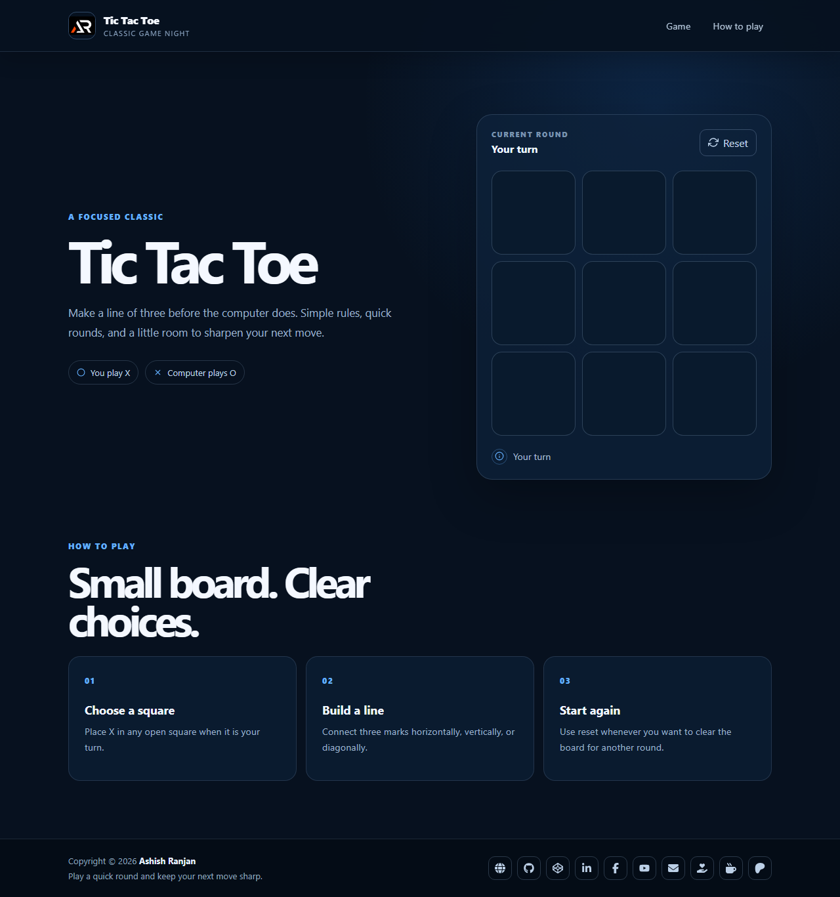

# Tic Tac Toe



A responsive React Tic Tac Toe game where you play X against a computer opponent. The project keeps the classic rules, adds a focused interface, clear turn status, reset controls, and a helpful responsive layout.

## Features

- Play a complete round against the computer
- Win, draw, and winning-line detection
- Computer move delay with simple move strategy
- Reset confirmation and accessible board controls
- Fixed responsive header with local logo
- Icon-only footer links and floating go-to-top button

## Tech stack

- React and Vite
- SCSS modules
- React Icons
- SweetAlert2

## Getting started

Requirements: Node.js 20.19+ or 22.12+ and npm.

```bash
npm install
npm run dev
```

Run the existing component check with `npm test`, check code style with `npm run lint`, and create a production build with `npm run build`. Deploy to GitHub Pages with `npm run deploy`.

## Future prospects

Future improvements could include score tracking, player name settings, selectable board themes, and additional difficulty levels.

## Live demo

[https://a2rp.github.io/tic-tac-toe-against-ai/](https://a2rp.github.io/tic-tac-toe-against-ai/)

## Links

- Portfolio: [https://www.ashishranjan.net/](https://www.ashishranjan.net/)
- GitHub: [https://github.com/a2rp](https://github.com/a2rp)
- CodePen: [https://codepen.io/ash1198](https://codepen.io/ash1198)
- LinkedIn: [https://www.linkedin.com/in/aashishranjan](https://www.linkedin.com/in/aashishranjan)
- Facebook: [https://www.facebook.com/theash.ashish/](https://www.facebook.com/theash.ashish/)
- YouTube: [https://www.youtube.com/@ashishranjan-ashz?sub_confirmation=1](https://www.youtube.com/@ashishranjan-ashz?sub_confirmation=1)
- Email: [ash.ranjan09@gmail.com](mailto:ash.ranjan09@gmail.com)

## Support

- Support: [https://a2rp-donation-page.netlify.app/](https://a2rp-donation-page.netlify.app/)
- Buy Me a Coffee: [https://buymeacoffee.com/a2rp](https://buymeacoffee.com/a2rp)
- Patreon: [https://www.patreon.com/a2rp](https://www.patreon.com/a2rp)
